<table>
<tr>
<td valign="top"></td>
<td valign="top"></td>
</tr>
</table>

## Riku Kaartoaho

**Software Developer · Entrepreneur · Building with AI**

 

<!-- animated contribution graph, refreshed daily by .github/workflows/update-graph.yml -->

The 3D demo is an unofficial student project, not produced or endorsed by Nokian Tyres.

